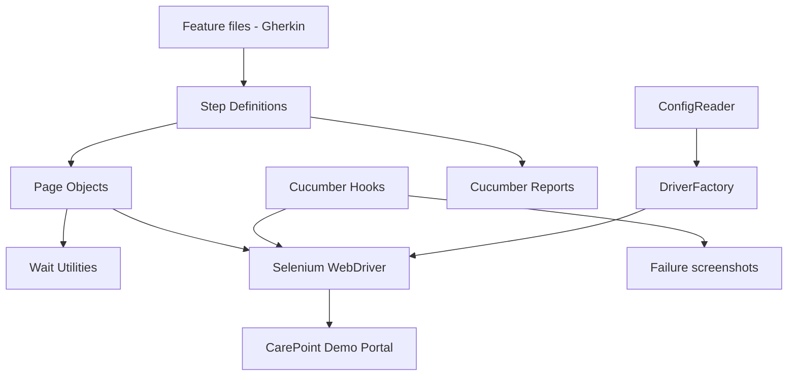

# CarePoint Healthcare Portal – UI Test Automation Framework

An advanced, portfolio-ready UI automation framework built with **Java 17, Selenium 4, Cucumber BDD, JUnit 4 and Maven**. It includes a small local demo healthcare portal so the test suite can be run without access to a third-party website or real patient data.

> **Safety/data note:** This is an educational demo. Use synthetic data only. It is not a real electronic health record (EHR), is not HIPAA-certified, and must not be used to store or process real patient information.

## Capabilities
- Role-based demo sign-in (administrator and healthcare staff)
- Patient registration workflow
- Appointment booking workflow
- Positive and negative authentication scenarios
- Page Object Model with reusable wait utilities
- ThreadLocal WebDriver lifecycle management
- Failure screenshots attached to Cucumber scenarios
- HTML, JSON and JUnit XML reports
- Chrome, Firefox and Edge configuration
- GitHub Actions CI workflow

## Architecture



### Design decisions
- **BDD:** Feature files express business-readable acceptance criteria.
- **Page Object Model:** Locators and browser actions are isolated from test intent.
- **Explicit waits:** Synchronization uses WebDriverWait rather than arbitrary sleeps.
- **ThreadLocal driver:** Supports safe driver ownership if parallel execution is introduced later; current runner executes scenarios sequentially.
- **Config overrides:** JVM properties can override the default browser, URL and headless setting.

## Prerequisites
- JDK 17+
- Maven 3.8+
- Python 3 (only to serve the local demo page)
- Google Chrome, Firefox or Microsoft Edge
- Selenium Manager resolves the compatible browser driver automatically in supported environments; internet access may be needed on first run.

## Run locally

Terminal 1 – start the demo portal:

```bash
python3 -m http.server 8080 --directory app/demo
```

Windows PowerShell equivalent:

```powershell
py -m http.server 8080 --directory app/demo
```

Open `http://localhost:8080` to view the demo. Demo accounts:

| Role | Email | Password |
|---|---|---|
| Administrator | admin@care.local | Care@123 |
| Healthcare Staff | staff@care.local | Staff@123 |

Terminal 2 – run all scenarios:

```bash
mvn clean test
```

Headless Chrome:

```bash
mvn clean test -Dbrowser=chrome -Dheadless=true
```

Firefox / Edge:

```bash
mvn clean test -Dbrowser=firefox
mvn clean test -Dbrowser=edge
```

Override application URL:

```bash
mvn clean test -Dbase.url=http://localhost:8080
```

Run selected tags (add `@smoke` or `@regression` above scenarios/features before using):

```bash
mvn test -Dcucumber.filter.tags="@smoke"
```

## Reports and evidence
After execution, inspect:
- `reports/cucumber.html` – human-readable Cucumber report
- `reports/cucumber.json` – machine-readable report for dashboards
- `reports/cucumber.xml` – JUnit-compatible report
- `reports/screenshots/` – screenshots captured for failed scenarios

The reports directory is generated by the test run and is not committed to source control.

## Test coverage
| Feature | Scenarios | Main assertions |
|---|---|---|
| Authentication | Admin login, staff login, invalid login | Dashboard identity / error message |
| Patient management | Register patient | Success confirmation |
| Appointment management | Book appointment | Booking confirmation |
| Session management | Logout | Return to login state |

## Suggested next-level enhancements
1. Add API automation with REST Assured and contract/schema validation.
2. Add database checks using JDBC against a dedicated test database.
3. Add Allure reporting, test retry policy and flaky-test tracking.
4. Add accessibility checks with axe-core.
5. Add environment-specific secrets through GitHub Actions secrets (never commit credentials).
6. Add role/permission matrix tests and validation for duplicate patients, invalid email, past appointment dates and missing fields.
7. Add parallel execution only after test data isolation is implemented.

## Important implementation notes
This repository is a runnable demonstration framework, not a production clinical system. The demo stores data in browser memory only; refreshing the page resets it. The sample login credentials are intentionally public and must never be reused in a real system. The sample app does not implement real authorization, encryption, audit logging or clinical safety controls.

## Suggested resume entry
**Healthcare Management System – UI Test Automation Framework** | Java, Selenium WebDriver, Cucumber BDD, JUnit, Maven, GitHub Actions
- Built a BDD-driven UI automation framework using Java, Selenium WebDriver and Cucumber to validate authentication, patient registration and appointment workflows.
- Applied Page Object Model, reusable explicit-wait utilities and centralized WebDriver lifecycle management to improve maintainability.
- Implemented positive and negative test scenarios, failure screenshot capture, and HTML/JSON/JUnit test reporting.
- Configured a GitHub Actions workflow to execute headless browser tests and publish reports as build artifacts.

**Only include this resume entry after you have run the project, reviewed the code, and can explain each component in an interview.**
Automated CI testing with Jenkins and Selenium.
